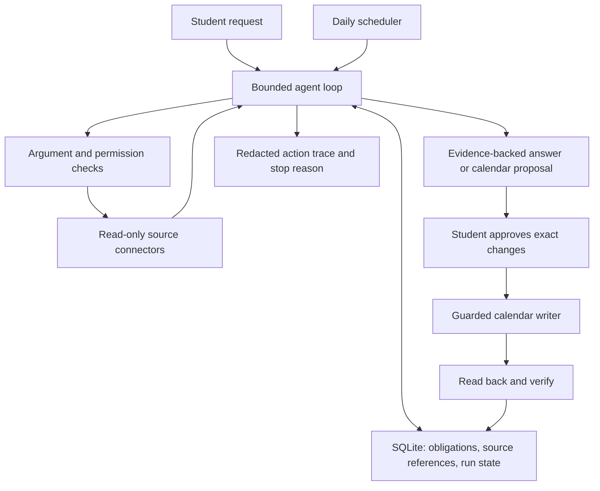

# Project Proposal — Semester Week 10

## Project Title

StudyRadar — Personal Academic Assistant Across Learning Platforms

Student: Ilias Nurlybek. Course: CSS 4007. Individual project.
Fork: https://github.com/Nurlybek-Iliyas/css4007-ai-agents-final
Planning period: 2–8 November 2026. Target submission: 22 December 2026.

## Problem Description

A fourth-year student must repeatedly open Canvas, Google Classroom, Gmail, Telegram and Microsoft Teams to find assignments, internship paperwork, consultations and messages requiring a response. Information is fragmented, and important obligations may be missed even when the number of formal assignments is small. A calendar alone does not explain what action a message requires.

StudyRadar will collect authorized information, identify actionable obligations, preserve supporting sources, and help the student decide what requires attention. The primary benefit is less manual checking and fewer missed obligations. Deadline changes are a supported edge case, not the main reason for the project.

## Target Users

Initially, one Narxoz University student using Canvas at https://canvas.narxoz.kz, Gmail, Classroom and selected academic Telegram/Teams conversations. Wider student access is a future extension requiring appropriate authorization and institutional permissions.

## Selected Difficulty

A — Autonomous multi-step agent. The implementation must demonstrate genuine model-selected tools, explicit state, adaptation to intermediate observations, bounded execution, guardrails, verified outcomes and at least twelve application tests. A recent research paper presentation is also required.

## Expected Functionality

- Answer natural-language requests about important recent messages, deadlines, internship requirements, meetings and other academic obligations.
- Read the five planned sources: Canvas, Gmail, Classroom, selected Telegram groups/channels and authorized Teams content. Their exact access mechanisms must be verified; none is implemented yet.
- Extract actions, dates, scope and supporting excerpts. Distinguish announcements from obligations and preserve unknown deadlines instead of inventing them.
- Reconcile related items across sources while retaining uncertain matches for clarification.
- Maintain task status and source freshness. Do not infer completion merely from an expired deadline or a read message.
- Explain prioritization using deadlines, dependencies and user preferences. Time remaining is calculated; effort estimates are labelled estimates.
- Run daily checks while the application/scheduler is running; show failures and stale sources explicitly.
- Preview additions/updates to a dedicated Google Calendar, obtain explicit approval for the exact changes, apply them and read back the result. Repeated checks must not duplicate events.
- Support additional scenarios by composing available tools; the initial examples are not a fixed menu or a limit of three commands.
- Provide a simple interface for questions, obligations, connection health and calendar proposals.

The first implementation milestone is a real Canvas read followed by a model-grounded answer. All integrations remain planned until successful authorized requests demonstrate access.

## Proposed Functions

The following are design specifications, not implemented functions. All source readers return source IDs/links, timestamps and structured errors in addition to content.

| Function | Purpose and inputs | Expected output | Dependencies |
|---|---|---|---|
| `get_canvas_assignments(course_ids, window)` | Read allowed courses, assignments, deadlines and available submission state | Assignment records, pagination and freshness | Canvas API, local credentials, course permissions |
| `search_gmail(query, window, cursor)` | Search authorized academic email in a bounded interval | Message references and summaries | Gmail authorization and API |
| `read_gmail_thread(thread_id)` | Retrieve context for a selected message | Messages with dates and source references | Gmail read permission |
| `get_classroom_work(course_ids, window)` | Read coursework and permitted student submission state | Coursework records | Classroom authorization and API |
| `read_telegram_messages(chat_ids, window, cursor)` | Read selected academic chats through an authorized access method | Messages and available attachment metadata | Verified Telegram access, allowlisted chats |
| `read_teams_updates(resource_ids, window, cursor)` | Retrieve authorized course messages or meetings | Records with source references, or explicit access errors | Microsoft authorization; tenant permissions to be checked |
| `normalize_obligation(candidate, evidence)` | Validate extracted action, date, scope and evidence | Valid obligation or validation errors | Data schemas, timezone handling |
| `reconcile_obligations(candidates, stored_items)` | Associate records with existing obligations | Proposed matches, conflicts and unresolved cases | SQLite, source IDs, evidence review |
| `get_calendar_events(window)` | Inspect existing events in the dedicated calendar | Event IDs, dates and metadata | Google Calendar authorization |
| `propose_calendar_changes(obligation_ids)` | Build a versioned preview without external writes | Proposed changes and proposal ID | Verified obligations, existing events |
| `apply_calendar_changes(proposal_id, approval_id)` | Apply only the exact changes approved through the UI | Per-change result and event IDs | Calendar API, application-side approval store |
| `verify_calendar_changes(event_ids, expected)` | Read back important fields | Verified/partial/failed outcomes | Calendar API |
| `run_agent(goal, scope, limits)` | Execute a bounded model/tool loop | Grounded response, trace and stopping reason | LLM adapter, tool registry, policy checks, storage |
| `run_daily_check(schedule_id)` | Trigger an authorized collection run | Updated findings and pending proposals | Scheduler, saved source scope; no unattended calendar writes |

## Proposed Agent Tools

Expose the five source readers, Gmail thread reader, calendar reader, change proposer and guarded apply/verify functions as typed tools. Readers provide evidence the model cannot know from training. The thread reader supports follow-up investigation. Calendar tools allow comparison, approved execution and verification.

The LLM selects relevant tools and arguments, observes results and can search further, ask for clarification or stop. Validation, permissions, approval matching and limits are enforced by application code. Internal normalization and scheduling are ordinary application functions rather than artificial tools added to meet a count.

## Model Selection

Proposed initial model: OpenAI `gpt-5.4-mini` through the Responses API, using function calling and structured outputs. This is a provisional engineering choice; account availability, extraction quality, latency and cost will be checked during Week 11 before committing to a deployment model. No real model calls or performance measurements have been made yet.

Model reference: https://developers.openai.com/api/docs/models/gpt-5.4-mini
A configurable adapter will permit a documented model change. No custom model training is required. Only necessary authorized content will be sent to the model; secrets remain outside model context and logs.

## Architecture

Proposed implementation: Python application, SQLite persistence and a small web interface. Keep the instructor's Node-based repository checks intact. See `docs/architecture.md` for boundaries, state and access risks. Source content is untrusted data, never application authority.

## Example Requests

1. “Какие важные сообщения пришли за последние три дня?”
2. “Что мне нужно сделать на этой неделе?”
3. “Проверяй дедлайны каждый день и подготовь обновления календаря.”
4. “Найди всё, что касается договора на практику.”
5. “Какие задания есть без указанного срока?”
6. “У меня сегодня два часа. С чего начать?”

These illustrate extensible behavior, not hard-coded routing rules. Calendar writes require a separate approval of the previewed changes.

## Evaluation Plan

Build at least twelve application tests, including prompt injection in a source, repeated tool failure, unauthorized/unapproved action and execution-limit exhaustion. Instructor starter tests do not count toward this minimum.

Use clearly labelled synthetic messages/assignments with manually reviewed expected actions, deadlines and evidence; supplement with a small authorized real-account demonstration. Keep personal data and credentials out of the public repository. Separate development and held-out scenarios by thread/scenario family.

Measure action extraction precision/recall, deadline correctness, evidence support, duplicate-event rate, safe failure behavior, run latency and token usage. Compare the agent with a single-prompt baseline using the same model and available source content. Report limitations and partial access instead of claiming universal coverage. Detailed planned cases are in `docs/evaluation.md`; no application evaluation has run yet.

## Weekly Milestones

| Week | Dates | Planned deliverable |
|---|---|---|
| 10 | Nov 2–8 | Proposal, architecture, function/tool specification, evaluation plan and initial access inventory |
| 11 | Nov 9–15 | Authorized Canvas read, real LLM request, initial Gmail access; resolve access risks for all sources |
| 12 | Nov 16–22 | Obligation schema, persistence, first tests, Classroom and Telegram integration work |
| 13 | Nov 23–29 | Authorized Teams integration, source reconciliation, end-to-end recent-message query |
| 14 | Nov 30–Dec 6 | State, adaptive tool loop, stopping conditions, calendar preview; submit paper selection |
| 15 | Dec 7–13 | Approved calendar writes and read-back, daily scheduler, guardrails and failure tests |
| 16 | Dec 14–20 | Held-out evaluation, fixes, usable interface, installation instructions and paper presentation |
| 17 | Dec 21–22 | Final report, test results, complete demo, final commit and technical defense |

Access limitations may change the integration sequence; any scope revision will be documented and discussed with the instructor. Development progress will be reported honestly each week.
